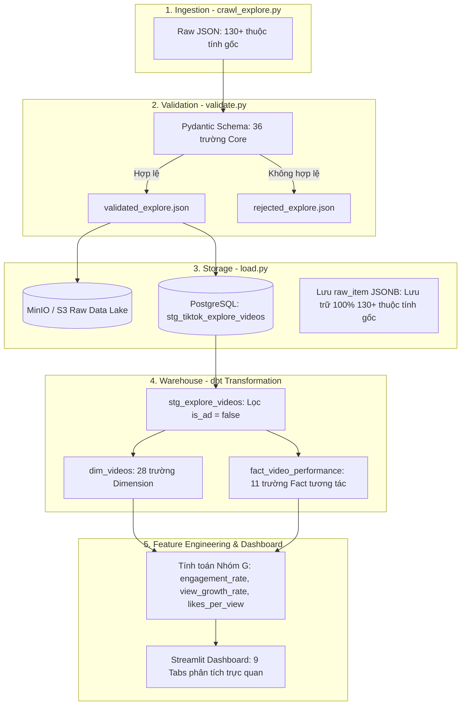

# 📊 TỪ ĐIỂN THUỘC TÍNH DỮ LIỆU TIKTOK (TIKTOK ATTRIBUTES DICTIONARY)

> Tài liệu này liệt kê **TẤT CẢ** các trường/thuộc tính (Attributes) có thể thu thập được từ TikTok Explore API cùng các **thuộc tính tự tạo (Derived Metrics/Features)**, đồng thời đánh dấu chi tiết những thuộc tính **ĐÃ ĐƯỢC SỬ DỤNG** và **CHƯA ĐƯỢC SỬ DỤNG** trong hệ thống Data Pipeline của dự án này nhằm phục vụ công tác nâng cấp kiến trúc và tính năng.

---

## 📌 1. BẢNG TỔNG QUAN THỐNG KÊ (EXECUTIVE SUMMARY)

| Phân loại thuộc tính | Số lượng | Mô tả nguồn gốc & Trạng thái |
| :--- | :---: | :--- |
| **Thuộc tính gốc từ TikTok Explore API** | **130+** | Các trường JSON trả về trực tiếp từ endpoint mạng của TikTok |
| **Thuộc tính tự tạo (Derived / Feature Engineering)** | **11** | Được sinh ra qua quá trình tính toán, gom nhóm, hoặc Machine Learning |
| **Tổng số thuộc tính ĐÃ ĐƯỢC SỬ DỤNG trong Project** | **42** | Đã tham gia vào luồng: Validation ➔ Postgres ➔ dbt Marts ➔ Streamlit |
| **Tổng số thuộc tính CHƯA ĐƯỢC SỬ DỤNG (Tiềm năng nâng cấp)** | **99+** | Đang lưu dạng raw JSONB hoặc là các chỉ số mới cần cài đặt thêm |

### Bảng ký hiệu trạng thái:
* `✅ ĐÃ DÙNG (Core)`: Đã trích xuất thành cột trong Data Warehouse (Postgres/dbt) và có biểu đồ/thống kê trên Dashboard.
* `⚠️ ĐÃ DÙNG (Filter/Raw/Một phần)`: Đang dùng làm điều kiện lọc (ví dụ: `isAd`), lưu dự phòng (`raw_item`), hoặc mới triển khai một phần.
* `⚪ CHƯA DÙNG (Có thể thu thập)`: Thuộc tính có sẵn trong API nhưng chưa trích xuất hoặc chưa khai thác logic.
* `❌ KHÔNG CÓ TRONG API EXPLORE`: Thuộc tính chỉ tồn tại ở các endpoint khác (ví dụ: trang cá nhân Profile) hoặc không được TikTok công khai.

---

## 📑 2. DANH MỤC CHI TIẾT THEO CÁC NHÓM THUỘC TÍNH

---

### NHÓM A — ĐỊNH DANH & NỘI DUNG VIDEO (IDENTIFICATION & CONTENT)

| Thuộc tính (JSON Path) | Kiểu dữ liệu | Ví dụ thực tế | Trạng thái trong Project | Vị trí áp dụng / Tiềm năng |
| :--- | :--- | :--- | :---: | :--- |
| `id` / `video_id` | `String` | `"7693226011021987092"` | ✅ **ĐÃ DÙNG** | Khóa chính duy nhất của video trong bảng `dim_videos` và `fact_video_performance`. |
| `desc` / `video_description` | `String` | `"Khang Rồng nhắm nổi team Tuấn Hamez ko e? #viral"` | ✅ **ĐÃ DÙNG** | Caption video, lưu vào cột `video_desc` phục vụ trích xuất từ khóa. |
| `createTime` / `create_time` | `Integer` | `1791218773` | ✅ **ĐÃ DÙNG** | Unix timestamp đăng video ➔ dbt đổi thành `created_at` (Timestamp). |
| `_category_name` / `source_tab` | `String` | `"Singing & Dancing"` | ✅ **ĐÃ DÙNG** | Tên tab chuyên mục crawl từ Explore (All, Comedy, Sports, Daily Life...). |
| `_category_id` | `Integer` | `120` | ✅ **ĐÃ DÙNG** | ID định danh chuyên mục Explore. |
| `crawled_at` | `Timestamp` | `2026-10-12 10:33:53+00` | ✅ **ĐÃ DÙNG** | Thời điểm crawler chạy thu thập dữ liệu (dùng làm timestamp nạp dữ liệu). |
| `share_url` | `String` | `"https://www.tiktok.com/@user/video/..."` | ⚠️ **TỰ TẠO / MỘT PHẦN** | API không trả về sẵn; project ghép chuỗi từ `author_username` và `video_id`. |
| `textLanguage` | `String` | `"vi"`, `"en"` | ⚪ **CHƯA DÙNG** | Mã ngôn ngữ của caption. Tiềm năng: lọc video theo thị trường ngôn ngữ. |
| `textTranslatable` | `Boolean` | `true` | ⚪ **CHƯA DÙNG** | Video có hỗ trợ dịch tự động sang ngôn ngữ khác hay không. |
| `textExtra[]` | `List[Dict]` | `[{"hashtagName": "viral", ...}]` | ⚪ **CHƯA DÙNG** | Chi tiết vị trí start/end của hashtag, mention user trong caption. |
| `textExtra[].userId` | `String` | `"668270135842..."` | ⚪ **CHƯA DÙNG** | ID của user được `@mention` trong caption (phân tích mạng lưới creator). |
| `textExtra[].userUniqueId` | `String` | `"tuanhamez"` | ⚪ **CHƯA DÙNG** | Username của tài khoản được tag/nhắc đến. |
| `CategoryType` | `Integer` | `120` | ⚪ **CHƯA DÙNG** | Phân loại danh mục cấp thuật toán nội bộ của TikTok. |
| `diversificationId` | `Integer` | `10075` | ⚪ **CHƯA DÙNG** | ID định tuyến nội dung đa dạng hóa của thuật toán For You. |
| `playlistId` | `String` | `""` | ⚪ **CHƯA DÙNG** | ID danh sách phát (Playlist/Series) nếu video nằm trong chuỗi video liên tục. |

---

### NHÓM B — CHỈ SỐ TƯƠNG TÁC (ENGAGEMENT METRICS)

| Thuộc tính (JSON Path) | Kiểu dữ liệu | Ví dụ thực tế | Trạng thái trong Project | Vị trí áp dụng / Tiềm năng |
| :--- | :--- | :--- | :---: | :--- |
| `stats.playCount` | `Integer` | `4300000` | ✅ **ĐÃ DÙNG** | Số lượt xem video (Views) ➔ Bảng Fact & KPI Dashboard. |
| `stats.diggCount` | `Integer` | `288100` | ✅ **ĐÃ DÙNG** | Số lượt thả tim (Likes) ➔ Bảng Fact & Tính Engagement Rate. |
| `stats.commentCount` | `Integer` | `2493` | ✅ **ĐÃ DÙNG** | Số lượng bình luận (Comments) ➔ Bảng Fact. |
| `stats.shareCount` | `Integer` | `184500` | ✅ **ĐÃ DÙNG** | Số lượt chia sẻ (Shares) ➔ Bảng Fact. |
| `stats.collectCount` | `Integer` | `10700` | ✅ **ĐÃ DÙNG** | Số lượt lưu video vào mục Yêu thích (Bookmarks/Saves). |
| `statsV2.repostCount` | `String/Int` | `1250` | ✅ **ĐÃ DÙNG** | **Lượt Repost (đăng lại)**: Đã tích hợp vào Pydantic validation, Staging, Fact table & Dashboard. |
| `digged` | `Boolean` | `false` | ⚪ **CHƯA DÙNG** | Trạng thái tài khoản crawler đã like video này chưa. |
| `collected` | `Boolean` | `false` | ⚪ **CHƯA DÙNG** | Trạng thái tài khoản crawler đã lưu video này chưa. |

---

### NHÓM C — THÔNG TIN NGƯỜI ĐĂNG (CREATOR / AUTHOR PROFILE)

| Thuộc tính (JSON Path) | Kiểu dữ liệu | Ví dụ thực tế | Trạng thái trong Project | Vị trí áp dụng / Tiềm năng |
| :--- | :--- | :--- | :---: | :--- |
| `author.id` | `String` | `"6682701358426309634"` | ✅ **ĐÃ DÙNG** | ID duy nhất của tác giả (`author_id`). |
| `author.uniqueId` | `String` | `"tuanhamez"` | ✅ **ĐÃ DÙNG** | TikTok Handle / Username (`author_username`). |
| `author.nickname` | `String` | `"Tuan Hamez"` | ✅ **ĐÃ DÙNG** | Tên hiển thị của kênh (`author_nickname`). |
| `author.verified` | `Boolean` | `false` / `true` | ✅ **ĐÃ DÙNG** | Tích xanh xác minh người nổi tiếng / thương hiệu chính chủ. |
| `authorStats.followerCount`| `Integer` | `338500` | ✅ **ĐÃ DÙNG** | Số người theo dõi kênh (`author_followers`). |
| `authorStats.followingCount`| `Integer` | `366` | ⚪ **CHƯA DÙNG** | Số lượng tài khoản kênh này đang theo dõi. |
| `authorStats.videoCount` | `Integer` | `1646` | ✅ **ĐÃ DÙNG** | Tổng số video creator đã đăng trên kênh (đo lường độ chăm chỉ) ➔ `dim_videos`. |
| `authorStats.heartCount` | `Integer` | `13600000` | ✅ **ĐÃ DÙNG** | **Tổng số lượt tim toàn kênh**: Đánh giá tầm vóc tổng thể của Creator ➔ `dim_videos`. |
| `author.signature` | `String` | `"Contact: 0365... tuan@gmail.com"` | ⚪ **CHƯA DÙNG (Bỏ qua)** | Tiểu sử Bio của kênh (theo quyết định tối ưu). |
| `author.avatarThumb` | `String (URL)`| `"https://p16-...100:100.jpeg"` | ⚪ **CHƯA DÙNG** | Link ảnh đại diện (avatar) để hiển thị lên bảng xếp hạng Dashboard. |
| `author.region_code` | `String` | `"VN"`, `"US"` | ❌ **KHÔNG CÓ TRÊN EXPLORE** | TikTok không trả về trường này ở feed Explore (chỉ có khi crawl trang cá nhân sâu). |
| `author.secUid` | `String` | `"MS4wLjABAAAA..."` | ⚪ **CHƯA DÙNG** | Token định danh người dùng bảo mật của ByteDance. |
| `author.commentSetting` | `Integer` | `0` | ⚪ **CHƯA DÙNG** | Cài đặt quyền bình luận của kênh. |
| `author.downloadSetting` | `Integer` | `3` | ⚪ **CHƯA DÙNG** | Cài đặt quyền cho phép tải video của kênh. |

---

### NHÓM D — ÂM THANH & HASHTAG (AUDIO, HASHTAGS & STICKERS)

| Thuộc tính (JSON Path) | Kiểu dữ liệu | Ví dụ thực tế | Trạng thái trong Project | Vị trí áp dụng / Tiềm năng |
| :--- | :--- | :--- | :---: | :--- |
| `music.id` | `String` | `"7690614870145026817"` | ✅ **ĐÃ DÙNG** | ID định danh bản nhạc (`music_id`). |
| `music.title` | `String` | `"âm thanh gốc - khang rồng"` | ✅ **ĐÃ DÙNG** | Tên bản nhạc / tiêu đề âm thanh (`music_title`). |
| `music.authorName` | `String` | `"🐉khang rồng🐉"` | ✅ **ĐÃ DÙNG** | Tác giả hoặc nghệ sĩ của bản nhạc (`music_author`). |
| `music.duration` | `Integer` | `12` (giây) | ✅ **ĐÃ DÙNG** | Thời lượng đoạn nhạc (`music_duration`). |
| `music.original` | `Boolean` | `true` | ✅ **ĐÃ DÙNG** | Có phải âm thanh gốc tự thu hay không (`music_is_original`). |
| `music.playUrl` | `String (URL)`| `"https://v45.tiktokcdn...mp3"` | ✅ **ĐÃ DÙNG** | URL phát file âm thanh mp3 để nghe trực tiếp trên Dashboard. |
| `challenges[].title` | `String` | `"TuanHamez"`, `"viral"` | ✅ **ĐÃ DÙNG** | Tách thành mảng `hashtag_list` ➔ Phân tích Top trending hashtags. |
| `effectStickers[]` | `List[Dict]` | `[{"ID": "123", "name": "Glitch"}]` | 🗑️ **ĐÃ LOẠI BỎ** | Đã loại bỏ khỏi Marts & Dashboard do phần lớn rỗng và không có giá trị phân tích. |
| `stickersOnItem[]` | `List[Dict]` | `[{"stickerText": ["text..."]}]` | ⚪ **CHƯA DÙNG** | Sticker dạng text/nhãn dán được chèn trực tiếp trên màn hình video. |
| `music.is_commerce_music` | `Boolean` | `true` | ✅ **ĐÃ DÙNG** | Nhạc có bản quyền thương mại ➔ `dim_videos.music_is_commerce`. |
| `music.tt2dsp` | `Dict` | `{"song_id": "...", "platform": 1}` | ⚪ **CHƯA DÙNG** | Thông tin bài hát phát hành trên Spotify, Apple Music. |

---

### NHÓM E — ĐẶC ĐIỂM KỸ THUẬT & NỘI DUNG (VIDEO SPECS, AI & TRANSCRIPT)

| Thuộc tính (JSON Path) | Kiểu dữ liệu | Ví dụ thực tế | Trạng thái trong Project | Vị trí áp dụng / Tiềm năng |
| :--- | :--- | :--- | :---: | :--- |
| `video.duration` | `Integer` | `7` (giây) | ✅ **ĐÃ DÙNG** | Thời lượng video (`video_duration`), dùng phân tích độ dài tối ưu. |
| `video.width` | `Integer` | `576` | ✅ **ĐÃ DÙNG** | Chiều rộng khung hình (`video_width`). |
| `video.height` | `Integer` | `1024` | ✅ **ĐÃ DÙNG** | Chiều cao khung hình (`video_height`). |
| `video.ratio` | `String` | `"540p"`, `"720p"` | ✅ **ĐÃ DÙNG** | Tỉ lệ khung hình / definition (`video_ratio`). |
| `video.cover` | `String (URL)`| `"https://p16-...origin.image"` | ✅ **ĐÃ DÙNG** | URL ảnh bìa thumbnail (`video_cover_url`) hiển thị trên Web. |
| `video.playAddr` | `String (URL)`| `"https://v16-webapp...mp4"` | ✅ **ĐÃ DÙNG** | Link stream video MP4 trực tiếp để phát trên Dashboard. |
| `video.downloadAddr` | `String (URL)`| `"https://v16-webapp...mp4"` | 🗑️ **ĐÃ LOẠI BỎ** | Đã loại bỏ khỏi Marts do URL CDN có token hết hạn sau 24h, tránh làm phình bảng. |
| `video.videoID` | `String` | `"v14044g50000db1t8c7og..."` | 🗑️ **ĐÃ LOẠI BỎ** | ID hash nội bộ của CDN, đã loại bỏ để tinh gọn warehouse. |
| `isAd` | `Boolean` | `false` / `true` | ⚠️ **ĐÃ DÙNG** | **Dùng làm cờ lọc**: Loại bỏ video quảng cáo ở Staging. |
| `ShowAIGC` / `AIGCDescription` | `Boolean/Str` | `true` / `"Tạo bằng AI"` | ✅ **ĐÃ DÙNG** | Cờ đánh dấu video do AI tạo ra (AIGC) ➔ `dim_videos.is_aigc`. |
| `video.claInfo.captionInfos[].url` (`voice_to_text`) | `String (URL)` | `"https://...subtitles.webvtt"` | ⚪ **CHƯA DÙNG** | **URL tải file phụ đề/lời thoại tự động (.vtt)**: Tiềm năng làm NLP transcript. |
| `video_label` | `String` | N/A | ❌ **KHÔNG CÓ TÊN NÀY** | Trong API thực tế phân rã thành: `diversificationId`, `CategoryType`, `challenges`. |
| `video.VQScore` | `String` | `"63.51"` | ⚪ **CHƯA DÙNG** | Điểm chất lượng video do AI TikTok tự chấm (Video Quality Score). |
| `video.volumeInfo.Loudness` | `Float` | `-16.7` (dB) | ⚪ **CHƯA DÙNG** | Âm lượng tiêu chuẩn của video. |
| `video.dynamicCover` | `String (URL)`| `"https://p16-...image"` | ⚪ **CHƯA DÙNG** | Ảnh bìa động (GIF cover) khi di chuột. |

---

### NHÓM F — TÍNH NĂNG & TRẠNG THÁI VIDEO (VIDEO FEATURES & STATUS FLAGS)

*(Kiểm tra tính khả thi và đối chiếu trực tiếp từ payload crawl thực tế)*

| Thuộc tính (JSON Path) | Kiểu dữ liệu | Thu thập được không? | Trạng thái trong Project | Ý nghĩa & Tiềm năng nâng cấp |
| :--- | :--- | :---: | :---: | :--- |
| `duetEnabled` | `Boolean` | **Có** (`true`/`false`) | ⚪ **CHƯA DÙNG** | Cho phép người xem Duet lại video hay không. Đo lường tính mở tương tác của nội dung. |
| `stitchEnabled` | `Boolean` | **Có** (`true`/`false`) | ⚪ **CHƯA DÙNG** | Cho phép người xem Stitch video hay không. Video mở Stitch thường có độ thảo luận cao hơn. |
| `shareEnabled` | `Boolean` | **Có** (`true`/`false`) | ⚪ **CHƯA DÙNG** | Có cho phép chia sẻ ra bên ngoài hay không. |
| `originalItem` | `Boolean` | **Có** (`true`/`false`) | ⚪ **CHƯA DÙNG** | Đánh dấu video là tác phẩm gốc của creator hay nội dung tổng hợp/re-up. |
| `privateItem` | `Boolean` | **Có** (`true`/`false`) | ⚪ **CHƯA DÙNG** | Video ở chế độ riêng tư hay công khai (Explore hầu hết là `false`). |
| `officalItem` | `Boolean` | **Có** (`true`/`false`) | ⚪ **CHƯA DÙNG** | Cờ đánh dấu video từ nhãn hàng / tổ chức chính thức (chính chủ). |
| `isPinnedItem` | `Boolean` | ❌ **KHÔNG CÓ Ở EXPLORE** | ❌ **KHÔNG CÓ** | Chỉ xuất hiện khi gọi endpoint trang cá nhân `user/video/list`. Explore feed không có trường này. |
| `itemCommentStatus` | `Integer` | **Có** (`0`: Mở, `1`: Khóa) | ⚪ **CHƯA DÙNG** | Trạng thái bật/tắt tính năng bình luận của video. |
| `isProhibited` / `isReviewing` | `Boolean` | **Có** (`true`/`false`) | ⚪ **CHƯA DÙNG** | Trạng thái video có đang bị hạn chế hoặc đang bị kiểm duyệt lại hay không. |

---

### NHÓM G — THUỘC TÍNH TỰ TẠO / BIẾN ĐỔI (DERIVED & FEATURE ENGINEERING)

*(Đây là nhóm chỉ số do Pipeline, dbt hoặc mô hình Machine Learning tự tính toán dựa trên dữ liệu gốc)*

| Thuộc tính tự tạo | Kiểu dữ liệu | Công thức / Phương pháp tính | Trạng thái trong Project | Vị trí áp dụng / Tiềm năng |
| :--- | :--- | :--- | :---: | :--- |
| `engagement_rate` | `Float` | `(likes + comments + shares + collects) / plays * 100` | ✅ **ĐÃ DÙNG** | **Chỉ số tương tác tổng hợp**: Tính tại `src/dashboard_components/data.py` và dùng trên toàn bộ 6 tabs. |
| `likes_per_view` | `Float` | `like_count / play_count` | ✅ **ĐÃ DÙNG** | Tỷ lệ like trên view (hiển thị trong Audience Engagement breakdown). |
| `comments_per_view` | `Float` | `comment_count / play_count` | ✅ **ĐÃ DÙNG** | Tỷ lệ bình luận trên view (đo lường độ tranh luận/thảo luận của nội dung). |
| `shares_per_view` | `Float` | `share_count / play_count` | ✅ **ĐÃ DÙNG** | Tỷ lệ chia sẻ trên view (đo lường sức lan truyền tự nhiên). |
| `view_growth_rate` | `Float` | `(play_count_T2 - play_count_T1) / play_count_T1` | ✅ **ĐÃ DÙNG** | Tốc độ tăng trưởng view theo thời gian: Đã có trong `tab_growth.py`. |
| `video_age_hours` | `Float` | `(crawled_at - created_at) tính theo giờ` | ✅ **ĐÃ DÙNG** | **Độ tuổi của video tại lúc lên trend**: Đã tích hợp tính toán trong `dim_videos`. |
| `virality_velocity` | `Float` | `play_count / video_age_hours` (views/hour) | ✅ **ĐÃ DÙNG** | **Vận tốc tăng trưởng view/giờ**: Đã tích hợp trong `fact_video_performance`. |
| `creator_tier` | `String` | Phân nhóm: `Nano (<10k)`, `Micro (10k-100k)`, `Macro`, `Mega` | ✅ **ĐÃ DÙNG** | **Phân khúc quy mô Creator**: Đã tích hợp trong `dim_videos`. |
| `content_category` | `String` | Gán nhãn chủ đề phụ (Gaming, Beauty, Food...) | ⚠️ **MỘT PHẦN** | Hiện tại dùng `category_name` có sẵn từ Explore tab. |
| `video_format` | `String` | Phân loại định dạng: *Review, Tutorial, Vlog, POV, Dance* | ✅ **ĐÃ DÙNG** | Rule-based regex phân loại kịch bản: Đã tích hợp trong `dim_videos`. |
| `classification_method` | `String` | Ghi nhận phương pháp: `Rule-based`, `Regex`, `LLM Prompting` | ⚪ **CHƯA DÙNG** | Metadata lưu trữ nguồn gốc của nhãn phân loại nội dung. |
| `classification_confidence` | `Float` | Điểm xác suất / độ tin cậy từ 0.0 đến 1.0 | ⚪ **CHƯA DÙNG** | Đánh giá độ chính xác của nhãn nội dung do mô hình AI gán. |
| `classification_version` | `String` | Ví dụ: `v1.0-rules`, `v2.0-gemini-flash` | ⚪ **CHƯA DÙNG** | Version control cho pipeline làm giàu dữ liệu (Data Enrichment). |

---

## 🏗️ 3. SƠ ĐỒ ÁNH XẠ THUỘC TÍNH XUYÊN SUỐT PIPELINE (END-TO-END FLOW)

---

## 🚀 4. LỘ TRÌNH ĐỀ XUẤT NÂNG CẤP DỰ ÁN (UPGRADE ROADMAP)

Dựa trên việc đối soát các thuộc tính chưa sử dụng ở **Nhóm F** và các thuộc tính tự tạo ở **Nhóm G**, dưới đây là 3 giai đoạn nâng cấp tối ưu nhất cho project:

### Giai đoạn 1: Nâng cấp tầng dbt Transformation (Nhanh & Hiệu quả ngay)
1. **Bổ sung `video_age_hours` vào `dim_videos`**:
   * Viết thêm vào dbt model: `ROUND(EXTRACT(EPOCH FROM (crawled_at - created_at)) / 3600.0, 1) AS video_age_hours`.
   * *Mục đích*: Phân tích xem video "vừa đăng là lên xu hướng ngay" hay "nội dung evergreen tích lũy lâu ngày mới bùng nổ".
2. **Trích xuất `duetEnabled` & `stitchEnabled` (Nhóm F)**:
   * Thêm 2 trường boolean này vào `dim_videos` để phân tích mối tương quan: Các video mở tính năng Duet/Stitch có đạt tỷ lệ chia sẻ (`shares_per_view`) cao hơn không?
3. **Thêm `repostCount` (`statsV2.repostCount`) vào `fact_video_performance`**:
   * Giúp hoàn thiện trọn vẹn bộ 5 chỉ số tương tác chuẩn của TikTok hiện đại.

### Giai đoạn 2: Tự động hóa Phân loại Nội dung (Nhóm G - Feature Engineering)
1. **Tạo cột `video_format`**:
   * Áp dụng Regex hoặc Rule-based trên `video_desc` và `hashtag_list` để gắn nhãn định dạng:
     * `#review`, `#danhgia` ➔ *Review / Đánh giá*
     * `#huongdan`, `#tutorial`, `#tips` ➔ *Hướng dẫn / How-to*
     * `#vlog`, `#daily`, `#cuocsong` ➔ *Vlog đời sống*
     * `#pov` ➔ *POV / Diễn xuất*
2. **Lưu vết Metadata**:
   * Bổ sung `classification_method = 'rule_based_v1'` để chuẩn bị cho việc tích hợp mô hình LLM sau này.

### Giai đoạn 3: Phân tích Văn bản Nâng cao (NLP & AI Transcript)
1. **Tải file phụ đề (`video.claInfo.captionInfos[].url`)**:
   * Khi crawler chạy, nếu video có phụ đề tự động, tiến hành tải file `.vtt` để lấy trọn vẹn lời thoại của video.
2. **Phân tích cảm xúc & Từ khóa**:
   * Chạy Sentiment Analysis hoặc trích xuất từ khóa trọng tâm bằng NLP, phục vụ trực tiếp cho tab phân tích kịch bản video.
