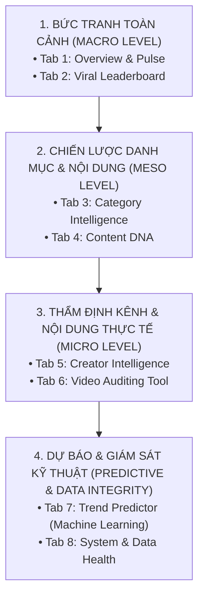

# 📖 TÀI LIỆU HƯỚNG DẪN PHÂN TÍCH DASHBOARD (DASHBOARD ANALYTICS GUIDE)
## Dành cho Stakeholders, Data Analysts & Đội ngũ Chiến lược Nội dung

> **Tài liệu xây dựng bởi:** Senior Data Analyst  
> **Dự án:** TikTok Explore Trend Data Product  
> **Phiên bản:** 2.0 (Kiến trúc 8 Tab theo Phễu Ra Quyết Định)

---

## 🎯 1. TỔNG QUAN TRIẾT LÝ THIẾT KẾ (DESIGN PHILOSOPHY)

Dashboard được thiết kế không phải như một "trình hiển thị dữ liệu thô" thông thường, mà là một **Hệ thống Hỗ trợ Ra Quyết định Chiến lược (Strategic Decision-Support System)**.

Hệ thống được tổ chức tuần tự theo **Phễu Phân Tích & Ra Quyết Định (Analytical Decision Funnel)** gồm 4 cấp độ:

Quy trình này giúp người dùng đi từ câu hỏi lớn: *"Hôm nay thị trường thế nào?"* ➔ *"Nên vào ngành nào?"* ➔ *"Sản xuất video theo công thức nào?"* ➔ *"Hợp tác với ai và đo lường thành công ra sao?"*.

---

## 📑 2. CHI TIẾT TỪNG TAB, BIỂU ĐỒ & GIÁ TRỊ PHÂN TÍCH

---

### 🏠 TAB 1: OVERVIEW & PULSE (BẮT MẠCH XU HƯỚNG THỊ TRƯỜNG)

* **Câu hỏi kinh doanh giải quyết:** Thị trường TikTok Explore hôm nay đang nóng ở mức độ nào? Có những tín hiệu bùng nổ nào cần nắm bắt trong 30 giây đầu tiên?

#### 1. Dàn thẻ chỉ số điều hành (Executive KPI Cards)
* **Các chỉ số:**
  * `Total Explore Views`: Quy mô tổng lượng xem trên toàn feed Explore hiện tại.
  * `Avg Virality Velocity`: Vận tốc xem trung bình theo giờ (`Views/Hour`).
  * `Avg Engagement Rate`: Tỷ lệ tương tác trung bình (chuẩn hóa gồm like, cmt, share, save, repost).
  * `Verified Ratio`: Tỷ lệ video đến từ tài khoản có tick xanh xác thực.
  * `AIGC Ratio`: Tỷ lệ video do trí tuệ nhân tạo (AI-generated) tạo ra được dán nhãn.
* **Giá trị phân tích:** Cung cấp đường cơ sở chuẩn (Baseline benchmark). Bất kỳ video hay danh mục nào có chỉ số vượt trên Baseline này đều là đối tượng cần quan tâm đặc biệt.

#### 2. Ma trận tín hiệu: Virality vs. Engagement Signal Matrix (Biểu đồ Scatter 4 Góc phần tư)
* **Cấu tạo:** 
  * Trục X: `Virality Velocity (Lượt xem/giờ)`.
  * Trục Y: `Engagement Rate (%)`.
  * Đường phân chia: Ngưỡng trung vị (Median) của toàn thị trường.
* **Ý nghĩa 4 góc phần tư:**
  1. 🔥 **Hot & Sticky (Vận tốc cao, Tương tác cao):** "Vàng mười" của xu hướng. Nội dung vừa kích thích người dùng bấm xem, vừa giữ chân và thôi thúc họ chia sẻ/bình luận. **Hành động: Mô phỏng ngay.**
  2. ⚡ **Fast Burn (Vận tốc cao, Tương tác thấp):** Lan tỏa nhanh nhưng nông (thường là giật tít, scandal hoặc tin tức thời vụ). **Hành động: Cân nhắc bắt trend nhanh, không đầu tư tài nguyên dài hạn.**
  3. 💎 **Niche Gold (Vận tốc thấp, Tương tác cao):** Lượng xem khiêm tốn nhưng người xem cực kỳ gắn kết (cộng đồng trung thành, giáo dục, tài chính chuyên sâu). **Hành động: Cơ hội khai thác thị trường ngách có tỷ lệ chuyển đổi cao.**
  4. 📉 **Fading Trend (Vận tốc thấp, Tương tác thấp):** Nội dung đã bão hòa hoặc hết độ nóng. **Hành động: Loại bỏ khỏi kế hoạch sản xuất.**

#### 3. Hộp tóm tắt phân tích tự động (AI Automated Summary Box)
* **Cấu tạo:** Khối tóm tắt rule-based dynamic insight.
* **Giá trị phân tích:** Trích xuất tự động các insight bất thường (Anomalies) và điểm sáng trong ngày, giúp ban điều hành nắm bắt mà không cần tự tính toán thủ công.

---

### 🔥 TAB 2: VIRAL LEADERBOARD (BẢNG XẾP HẠNG & GIẢI MÃ TOP 1%)

* **Câu hỏi kinh doanh giải quyết:** Video nào đang dẫn đầu cuộc đua xu hướng? Những clip "ngựa ô" mới xuất hiện dưới 24h là ai?

#### 1. Thẻ chỉ số nhịp đập nhanh (Top Velocity, Median Age, Fast Risers)
* **Giá trị phân tích:** Định lượng độ tuổi trung bình của video trending (thường từ 24h - 72h). Nếu số lượng `Fast Risers (<24h)` tăng vọt, thị trường đang có biến động lớn về hành vi người xem.

#### 2. Bảng dữ liệu tương tác đa chiều (Sortable Viral Table)
* **Thuộc tính hiển thị:** Hạng, Ảnh bìa, Tiêu đề, Creator (gắn huy hiệu Tier), Danh mục, Lượt xem, **Vận tốc (Views/hr)**, **Tương tác (%)**, **Tuổi video (Giờ)**.
* **Giá trị phân tích:** 
  * Sắp xếp theo `Views/hr`: Tìm ra video đang tăng trưởng nhanh nhất ngay lúc này.
  * Sắp xếp theo `Engagement %`: Tìm ra video có nội dung chạm đến cảm xúc sâu sắc nhất.

#### 3. Trình giải mã chi tiết video (Drill-down Inspector)
* **Cấu tạo:** Bấm mở rộng từng video để xem chi tiết số lượt Thả tim, Bình luận, Chia sẻ, Lưu (Bookmark), Đăng lại (Repost), tên bài hát và danh sách Hashtag gốc.
* **Giá trị phân tích:** Phục vụ quy trình **Reverse-Engineering (Dịch ngược công thức viral)**.

---

### 📊 TAB 3: CATEGORY INTELLIGENCE (CHIẾN LƯỢC SÂN CHƠI DANH MỤC)

* **Câu hỏi kinh doanh giải quyết:** Nên đổ ngân sách và nhân lực vào ngành hàng nào? Ngành nào là "đại dương xanh" cho người mới, ngành nào đã bão hòa?

#### 1. Total Explore Views by Category (Biểu đồ Thanh Ngang + Color Scale)
* **Cấu tạo:** Chiều dài thanh là `Total Views`, màu sắc thể hiện `Average Engagement Rate`.
* **Giá trị phân tích:** Nhận diện cán cân lưu lượng: Ngành nào đang thu hút sự chú ý lớn nhất từ người dùng và mức độ hào hứng của khán giả trong ngành đó.

#### 2. Category: Velocity vs. Engagement (Scatter Bubble Plot)
* **Cấu tạo:** Trục X là Vận tốc trung bình, Trục Y là Tỷ lệ tương tác trung bình, kích thước bóng là Tổng lượt xem.
* **Giá trị phân tích:** Định vị ngành hàng có "đòn bẩy thuật toán" mạnh nhất (tốc độ lan truyền cao mà vẫn giữ được sự quan tâm của khán giả).

#### 3. Creator Tier Mix by Category (Biểu đồ Thanh Xếp Chồng Chuẩn Hóa 100%)
* **Cấu tạo:** **100% Horizontal Stacked Bar Chart** chia theo 4 tầng Creator: *Nano (<10k)*, *Micro (10k-100k)*, *Macro (100k-1M)*, *Mega (1M+)*, kèm nút chuyển sang *Đếm số lượng thực tế*.
* **Tại sao không dùng Treemap?** 
  * Treemap bị lỗi méo mó hiển thị do ngành *Singing & Dancing* chiếm 70-80% số video, đè bẹp các ngành khác thành các ô không đọc được.
  * Biểu đồ chuẩn hóa 100% đưa mọi ngành về cùng một thang đo đồng nhất.
* **Giá trị hành động (Actionable Value):**
  * 🟢 **Phát hiện Sân chơi mở:** Ngành có tỷ lệ **Nano** cao (thanh màu xanh ngọc dài) chứng tỏ thuật toán rất cởi mở đẩy video của kênh nhỏ lên xu hướng. Kênh mới nên bắt đầu từ đây!
  * ⚔️ **Phát hiện Thị trường bão hòa:** Ngành có tỷ lệ **Mega/Macro** cao (thanh tím/đỏ chiếm đa số) chứng tỏ cạnh tranh khốc liệt, đòi hỏi đầu tư lớn vào sản xuất và gương mặt đại diện.

#### 4. Xu hướng tăng trưởng lũy kế theo thời gian (Category Growth Over Time)
* **Cấu tạo:** Multi-line chart theo dõi tổng view của từng danh mục qua các đợt crawl.
* **Giá trị phân tích:** Phát hiện sự trỗi dậy hoặc thoái trào của từng chủ đề qua chuỗi thời gian nhiều ngày.

---

### 🎵 TAB 4: CONTENT DNA (GIẢI PHẪU CÔNG THỨC SẢN XUẤT NỘI DUNG)

* **Câu hỏi kinh doanh giải quyết:** Video nên quay dọc hay ngang? Thời lượng tối ưu là bao nhiêu giây? Dùng âm thanh gì và gắn hashtag nào?

#### 1. Phân tích Định dạng & Thời lượng (Format & Duration Optimization)
* **Cấu tạo:** 
  * Biểu đồ so sánh hiệu suất giữa Video dọc (Vertical 9:16) và Video ngang (Horizontal 16:9).
  * Biểu đồ phân bổ thời lượng theo 4 khoảng: `<15s`, `15s-30s`, `30s-60s`, `>60s`.
* **Giá trị phân tích:**
  * Giúp đội ngũ sản xuất tìm ra **"Điểm ngọt thời lượng (Sweet Spot)"** để tối ưu hóa **Tỷ lệ giữ chân người xem (Retention / Completion Rate)** — yếu tố xếp hạng số 1 của thuật toán TikTok.

#### 2. Trí tuệ Âm thanh (Audio & Music Intelligence)
* **Cấu tạo:** 
  * Top bảng xếp hạng bài hát/âm thanh trending theo lượt view.
  * Biểu đồ Donut phân chia tỷ lệ giữa Âm thanh gốc (Original) và Âm thanh thương mại (Commercial Music).
* **Giá trị phân tích:** Giúp Brand Marketing chọn đúng nhạc đang thịnh hành mà vẫn tuân thủ bản quyền thương mại (`music_is_commerce = true`) khi chạy kênh doanh nghiệp.

#### 3. Phân tích Hashtag Lan Tỏa (Hashtag Reach & Engagement)
* **Cấu tạo:** Bảng và biểu đồ tần suất Top Hashtag cùng mức độ tương tác trung bình đi kèm.
* **Giá trị phân tích:** Lựa chọn đúng bộ hashtag hạt giống (Seed Hashtags), tránh sử dụng các hashtag bị bão hòa hoặc giảm tương tác.

---

### 👤 TAB 5: CREATOR INTELLIGENCE (CHIẾN LƯỢC KÊNH & BOOKING INFLUENCER)

* **Câu hỏi kinh doanh giải quyết:** Kênh nhỏ có cơ hội lên xu hướng không? Có nên chi tiền booking tài khoản tick xanh?

#### 1. Tương quan Lượt xem vs. Người theo dõi (Views vs. Followers Scatter - Log Scale)
* **Cấu tạo:** Trục X là Followers (thang Logarit), Trục Y là Views, kích thước bóng là Tương tác.
* **Giá trị phân tích (Kiểm chứng thuật toán):** 
  * Biểu đồ này chứng minh một sự thật cốt lõi của TikTok: **View phân phối dựa trên giá trị nội dung, không dựa vào quy mô kênh**. Kênh vài nghìn follow vẫn có thể đạt hàng triệu view ngang ngửa kênh triệu sub.
  * Giúp doanh nghiệp tự tin triển khai chiến lược **Micro-Influencer Marketing** để tối đa hóa hiệu quả trên từng đồng chi phí.

#### 2. Thẩm định Tài khoản Xác thực (Verified vs. Non-Verified)
* **Cấu tạo:** So sánh đối đầu giữa tài khoản Tick xanh và Tài khoản thông thường.
* **Giá trị phân tích:** Xác định xem huy hiệu xác minh có mang lại lợi thế phân phối tự nhiên (Organic Boost) hay không trong giai đoạn khảo sát.

---

### 🎬 TAB 6: VIDEO AUDITING TOOL (CÔNG CỤ MỔ XẺ CHI TIẾT HIỆN TRƯỜNG)

* **Câu hỏi kinh doanh giải quyết:** Video viral thực tế trông như thế nào? Hook 3 giây đầu, visual và caption được xây dựng ra sao?

* **Công dụng:** 
  * Nhúng trực tiếp trình phát video, nghe file nhạc gốc, xem ảnh bìa (Cover URL).
  * Kiểm tra toàn bộ thuộc tính kỹ thuật: Độ phân giải pixel, ngôn ngữ caption, gắn nhãn quảng cáo tài trợ (`is_ad`), nhãn nội dung AI (`is_aigc`).
* **Giá trị phân tích:** Cầu nối sống động giữa các con số thống kê và trải nghiệm người xem thực tế.

---

### 🤖 TAB 7: TREND PREDICTOR (MÔ HÌNH DỰ BÁO TIỀM NĂNG VIRAL)

* **Câu hỏi kinh doanh giải quyết:** Video chuẩn bị sản xuất có khả năng trở thành Hot Trend không? Yếu tố nào đóng vai trò quyết định nhất?

#### 1. Bộ chấm điểm xác suất bùng nổ (Viral Probability Scorer)
* **Công dụng:** Cho phép người dùng nhập các thuộc tính dự kiến (Thời lượng, Ngành hàng, Quy mô follower, Tốc độ tương tác ban đầu). Mô hình Machine Learning sẽ tính toán xác suất đạt tiêu chuẩn Hot Trend.
* **Giá trị phân tích:** Giúp đánh giá và tinh chỉnh các biến số (như rút ngắn thời lượng hoặc đổi danh mục) trước khi chính thức bấm đăng video.

#### 2. Trọng số đóng góp của thuộc tính (Feature Importance Chart)
* **Dạng biểu đồ:** Bar chart xếp hạng các yếu tố ảnh hưởng mạnh nhất đến khả năng lên xu hướng.
* **Giá trị phân tích:** Chỉ ra "đòn bẩy" quan trọng nhất cần tối ưu (ví dụ: Tỷ lệ lưu video vào yêu thích hay Tốc độ xem trong giờ đầu tiên).

---

### ⚙️ TAB 8: SYSTEM & DATA HEALTH (GIÁM SÁT TOÀN VẸN DỮ LIỆU)

* **Câu hỏi kinh doanh giải quyết:** Dữ liệu dashboard có đáng tin cậy không? Pipeline ETL có hoạt động ổn định và cập nhật mới nhất không?

* **Công dụng:** 
  * Theo dõi mốc thời gian crawl gần nhất, khối lượng bản ghi hợp lệ trong Data Warehouse PostgreSQL.
  * Giám sát kết quả kiểm thử chất lượng dữ liệu (dbt tests) để phát hiện sớm các lỗi schema, trùng lặp hoặc bản ghi thiếu.
* **Giá trị phân tích:** Đảm bảo **Data Integrity** tuyệt đối, tạo sự tin cậy vững chắc cho mọi quyết định kinh doanh dựa trên Dashboard.

---

## 📌 3. TỔNG KẾT BỘ CHỈ SỐ HÀNH ĐỘNG DÀNH CHO QUẢN LÝ (CHEAT SHEET)

| Chỉ số / Biểu đồ | Ngưỡng đánh giá tốt (Benchmark) | Hành động khuyến nghị |
| :--- | :--- | :--- |
| **Virality Velocity** | `> 25,000 views/giờ` | Đang trong giai đoạn bùng nổ mạnh ➔ Khảo sát và đu trend ngay. |
| **Engagement Rate** | `> 8.0%` (kể cả Repost & Save) | Khán giả yêu thích sâu sắc ➔ Áp dụng cấu trúc kịch bản này. |
| **100% Stacked Bar (Nano %)** | `> 40%` trong ngành hàng | Ngành hàng dễ tiếp cận ➔ Ưu tiên phân bổ nguồn lực sản xuất. |
| **Duration Sweet Spot** | Thường từ `15s - 34s` | Cắt gọt bớt đoạn thừa, giữ nhịp độ nhanh để tăng Completion Rate. |
| **Save / Repost Ratio** | Tỷ lệ Save + Repost chiếm `> 30%` tổng tương tác | Nội dung có giá trị lưu trữ/chia sẻ cao ➔ Định hướng làm nội dung hướng dẫn, mẹo hữu ích. |
